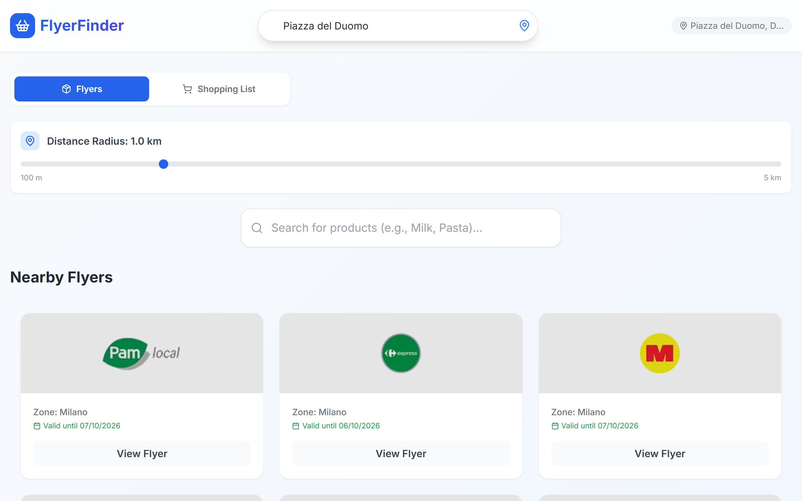
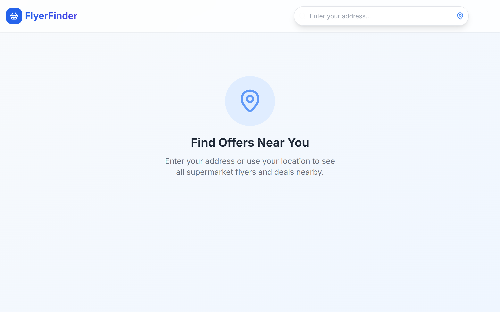
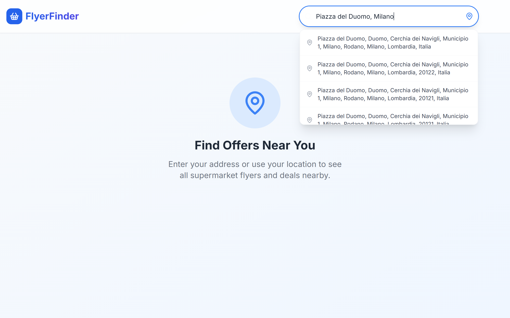
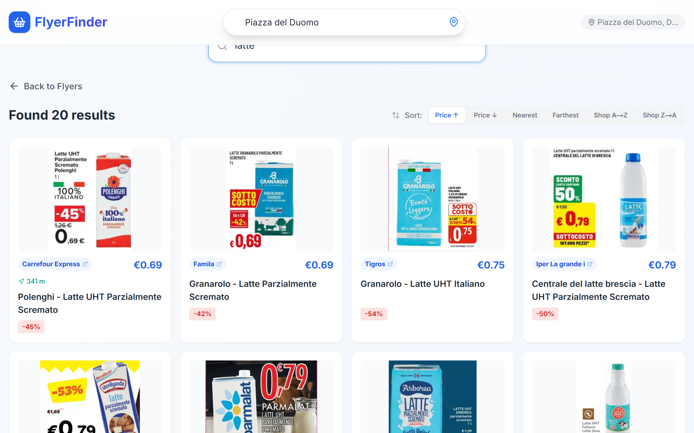
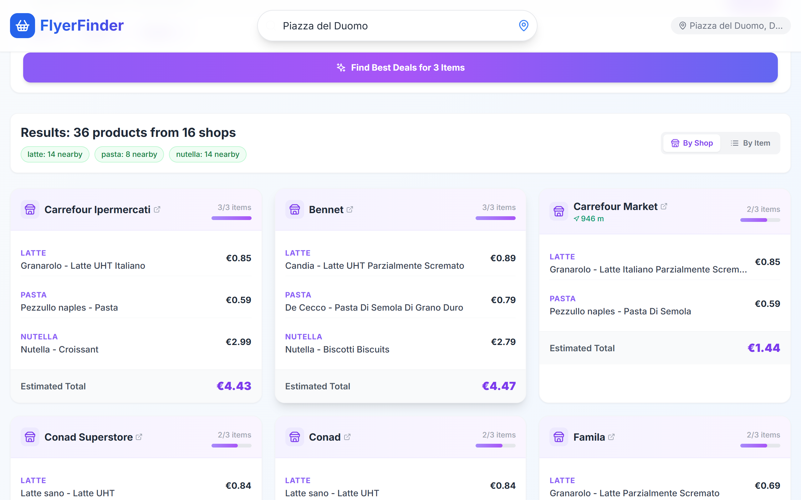

# FlyerFinder

Find supermarket flyers and grocery deals near any address in Italy, search for a product across nearby shops, and compare a whole shopping list to see where it costs least.

Runs as a website or as a standalone Android app. Data comes from [PromoQui](https://www.promoqui.it), read by [`lib/promoqui.js`](lib/promoqui.js).



## Features

- **Location search**: type an address (geocoded with OpenStreetMap Nominatim) or use the browser's location.
- **Nearby flyers**: grocery flyers around that position, filterable by distance (100 m – 5 km).
- **Flyer viewer**: open any flyer and scroll through its pages.
- **Product search**: current offers for a product near you, with price and discount.
- **Shopping list**: search every item at once and compare shops by estimated total, or compare items one by one.

## Screenshots

| | |
|---|---|
|  |  |
|  |  |



## Getting started

Requires Node.js 18 or later.

```bash
npm install
npm run dev
```

Open [http://localhost:3000](http://localhost:3000).

## Android app

The app in [`android/`](android) is the same interface packaged with [Capacitor](https://capacitorjs.com). It needs no server: it reads PromoQui and Nominatim directly from the phone.

To build it you need [Android Studio](https://developer.android.com/studio) (its setup wizard installs the Android SDK) and JDK 21. Then:

```bash
npm run build:android
```

This writes a debug APK to `dist/FlyerFinder.apk`. Copy it to the phone and open it to install, allowing installs from unknown sources when Android asks. On the phone, the back button closes an open flyer and returns from product results to the flyers.

## How it works

[`lib/promoqui.js`](lib/promoqui.js) reads PromoQui with plain HTTP requests:

| Function | What it does |
|---|---|
| `getNearbyFlyers` | Lists grocery flyers near a position through PromoQui's flyer listing |
| `searchProducts`, `searchShoppingList` | Read product offers near a position from PromoQui's offer and search pages |
| `getFlyerPages` | Resolves a flyer's page images from its publication |

[`lib/dataSource.js`](lib/dataSource.js) decides where the interface gets its data:

- **Website**: from the Next.js API routes in [`app/api`](app/api), which run `lib/promoqui.js` on the server. Browsers cannot call PromoQui directly because of cross-origin rules.
- **Android app**: from `lib/promoqui.js` running in the app, using Android's native HTTP stack, which those rules do not apply to.

The API routes are named `route.server.js` so that the Android build, a static export, leaves them out (see [`next.config.mjs`](next.config.mjs)).

The code depends on how promoqui.it is built, so it may need updating when the site changes.
